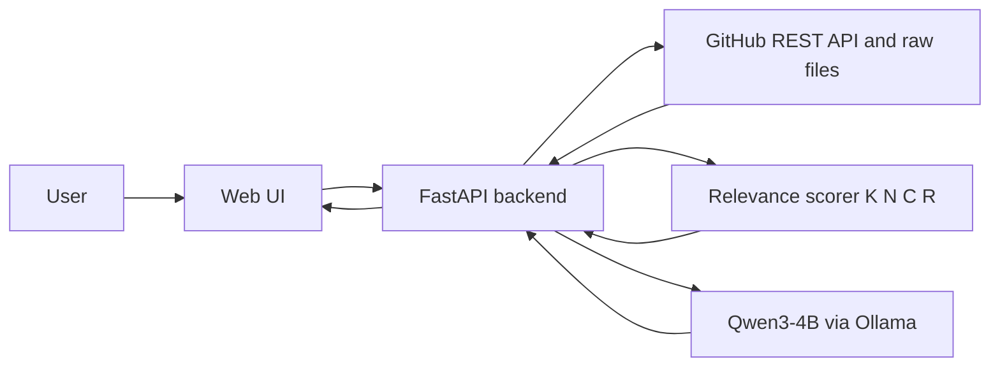
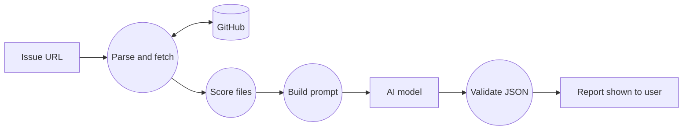
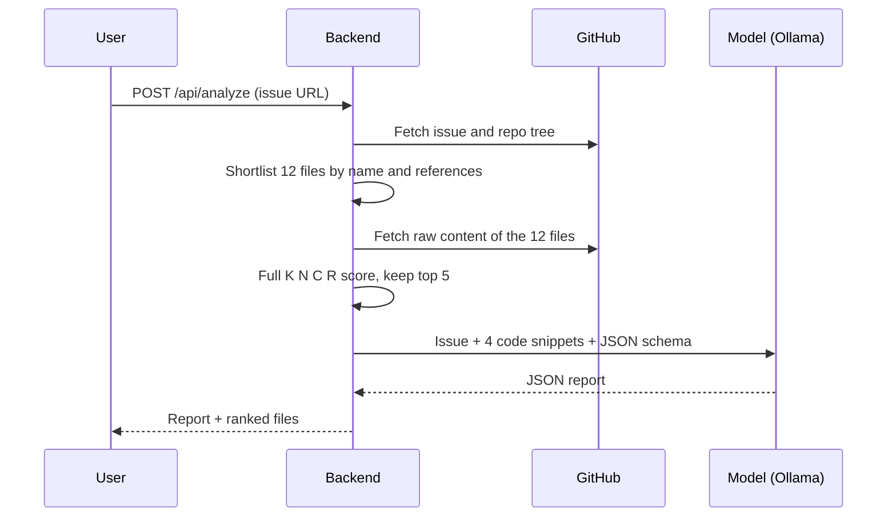

# IssuePilot AI

**Turn a confusing GitHub issue into a clear starting plan, powered by a small open-weight model (4B parameters) running locally.**

Hacktoberfest Islamabad 2026 · Open AI Build Challenge · Domain: **Developer & Open Source**

---

## Problem

Beginners who open a GitHub issue often cannot tell:
- what the issue actually asks for,
- which files in the repository they should edit,
- how to start implementing the change,
- what to test afterwards.

## Solution

Paste a public GitHub issue URL. IssuePilot AI fetches the issue and the repository tree through the GitHub REST API, **ranks the most relevant files with an original scoring algorithm**, and asks an open-weight model to write a beginner-friendly report with six parts:

1. Issue summary
2. Requirements
3. Relevant files
4. Why those files
5. Implementation plan
6. Testing checklist

**Target users:** students, first-time open-source contributors, hackathon participants.


<!-- Add a screenshot or GIF of a real run at docs/screenshot.png before submitting. -->

## AI component (model disclosure)

| Item | Details |
|---|---|
| **Model** | `qwen3:4b` (Qwen3-4B, **4 billion parameters**, 4-bit quantised) |
| **Runtime** | [Ollama](https://ollama.com), running **locally** on the demo laptop (CPU, 8 GB RAM) |
| **Size rule** | 4B, which is within the 8B-parameter maximum |
| **Optional test backend** | OpenRouter free-tier model of 8B or less, set with `OPENROUTER_MODEL` in `.env` (model used in testing: `_fill in the exact model ID you used, or delete this row_`) |
| **Model licence** | Qwen3 is released under Apache-2.0 |

**How the model is integrated:** the backend builds a prompt from the issue text and code snippets of the top-ranked files, sends it to Ollama's `/api/chat` endpoint with JSON output enabled, then validates the JSON and shows it in the UI.

**Why AI is important here:** the model produces the summary, requirements, per-file reasoning, implementation plan and testing checklist. Without it, the project would only be a file-ranking list. The scoring algorithm finds candidate files, but only the model explains them in plain language.

**Note on providers:** the code also contains an optional Groq adapter. It is not used, because Groq retired its Llama 3.1 8B model on 2026-08-16 and its replacements are larger than 8B.

## Original contribution: relevance-scoring algorithm

Files are ranked with a weighted score (no database, no embeddings):

```
Score = w1·K + w2·N + w3·C + w4·R        (each component normalised to 0..1)
```

| Symbol | Component | How it is computed | Default weight |
|---|---|---|---|
| **K** | Keyword match | Issue keywords (title counts 3x) found in the file's content, log-scaled | 0.25 |
| **N** | Name / path match | Issue keywords found in the file name (1.5x) or folder path | 0.30 |
| **C** | Code context | Exact identifiers from the issue (backticked, camelCase, snake_case) found in the file | 0.25 |
| **R** | Issue reference | The issue names the file path, file name or folder | 0.20 |

Two stages keep it fast: a path-only pass over the whole tree (N and R) shortlists 12 files, then only those are downloaded and fully scored. The UI shows each file's score as a bar split into the four components.

Code: `app/scoring.py`. Tests: `tests/test_scoring.py`.

## Architecture



### Data flow diagram



### Sequence diagram



**ER diagram:** not applicable. The project has no database. It is stateless.

## Setup

**Requirements:** Python 3.10+, [Ollama](https://ollama.com), internet access (for the GitHub API).

```bash
# 1. Get the code
git clone https://github.com/<your-username>/issuepilot-ai.git
cd issuepilot-ai

# 2. Python environment
python -m venv .venv
.venv\Scripts\activate            # Mac/Linux: source .venv/bin/activate
pip install -r requirements.txt

# 3. Configuration
copy .env.example .env            # Mac/Linux: cp .env.example .env

# 4. Model
ollama pull qwen3:4b

# 5. Run
uvicorn app.main:app --reload
```

Open **http://localhost:8000**, choose **Local (Ollama)**, paste an issue URL such as `https://github.com/owner/repo/issues/123`, and click **Analyze issue**. On an 8 GB CPU-only laptop the first run can take a few minutes while the model loads.

### Configuration (`.env`)

| Variable | Purpose |
|---|---|
| `LLM_PROVIDER` | `ollama` (default) or `openrouter` |
| `OLLAMA_HOST`, `OLLAMA_MODEL`, `OLLAMA_NUM_CTX` | Local model settings (`qwen3:4b`, context 4096) |
| `OPENROUTER_API_KEY`, `OPENROUTER_MODEL` | Optional API backend for testing; the model must be 8B or less |
| `GITHUB_TOKEN` | Optional, raises GitHub's limit from 60 to 5,000 requests per hour. No scopes needed |

Never commit `.env`. It is excluded by `.gitignore`.

### Minimal usage example

```bash
curl -X POST http://localhost:8000/api/analyze \
  -H "Content-Type: application/json" \
  -d '{"url": "https://github.com/owner/repo/issues/123", "provider": "ollama"}'
```

## Testing

```bash
python -m pytest -q
```

Unit tests cover: issue-URL parsing, file-ranking behaviour (a file named in the issue outranks an unrelated one), score weights summing to 1, JSON extraction from model output (including `<think>` blocks), and protection against invented file paths.

### Test findings

> Fill this table with **your own real runs** before submitting. Do not copy results you did not observe.

| # | Scenario | Input | Expected | Actual | Pass/Fail |
|---|---|---|---|---|---|
| 1 | Issue names a file | _issue URL_ | Named file ranks #1 | _fill in_ | _fill in_ |
| 2 | Issue without file hints | _issue URL_ | A relevant file in the top 5 | _fill in_ | _fill in_ |
| 3 | Report structure | any issue | Valid JSON with all 6 sections | _fill in_ | _fill in_ |
| 4 | Local latency | `qwen3:4b`, 8 GB RAM, CPU | Report completes | _fill in time_ | _fill in_ |
| 5 | Invalid URL | `https://example.com` | Clear error message | Returns "Enter a link like https://github.com/owner/repo/issues/123" | Pass |
| 6 | Private or missing repo | non-existent issue | Clear error message | _fill in_ | _fill in_ |

**Observed issues:** _write what you actually noticed during testing._

### Known limitations
- Ranking is lexical (keywords, names, identifiers), so issues that describe behaviour without naming any code can rank files poorly.
- Only the first ~24 KB of each shortlisted file is read, and only 4 snippets of about 1,100 characters go to the model.
- A 4B model can give generic plan steps and may occasionally return malformed JSON (the backend then shows the raw text as the summary).
- Very large repositories may return a truncated file tree from GitHub.
- Unauthenticated GitHub access is limited to 60 requests per hour.

## Security and privacy

- No API keys, tokens or passwords are committed; secrets are read from `.env` only.
- The final demo runs the model locally, so issue text is not sent to a third-party AI provider.
- Only public repositories are analysed.

## Project structure

```
app/
  main.py        FastAPI app and analysis pipeline
  github.py      GitHub REST client
  scoring.py     Relevance-scoring algorithm (K, N, C, R)
  llm.py         Ollama / OpenRouter adapters, prompt, JSON validation
frontend/
  index.html     Single-page UI
tests/
  test_scoring.py
```

## Team

| Name | Contribution |
|---|---|
| Huzaifa | _fill in: e.g. idea, scoring design, testing, documentation, demo_ |

**AI-assisted development disclosure:** the code was developed with the help of an AI assistant (Claude by Anthropic), then reviewed, run and tested by the team. The project idea, scoring-algorithm design and testing are the team's own. This is disclosed as the event rules ask for transparency about AI-assisted development tools.

## License

Released under the **MIT License**. See [LICENSE](LICENSE).

## Acknowledgements

- [Qwen3](https://github.com/QwenLM/Qwen3) by the Qwen team at Alibaba Cloud (Apache-2.0), the open-weight model used
- [Ollama](https://ollama.com) (MIT), local model runtime
- [FastAPI](https://fastapi.tiangolo.com), [Uvicorn](https://www.uvicorn.org), [httpx](https://www.python-httpx.org), [python-dotenv](https://github.com/theskumar/python-dotenv)
- [GitHub REST API](https://docs.github.com/en/rest), source of issue and repository data
- [OpenRouter](https://openrouter.ai), optional API gateway used for testing
- Hacktoberfest Islamabad 2026, powered by MLH and organized by CNCF Islamabad
